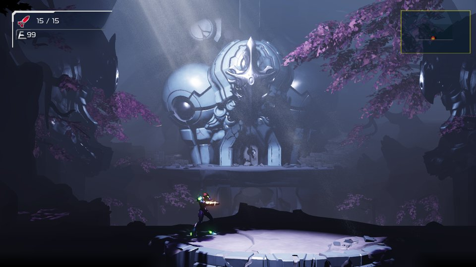

# nxnative

Play your own Nintendo Switch games natively on iPhone and iPad. Bring your game (its NSP files) and your `prod.keys`; one script turns them into an IPA that you sideload.

It is not an emulator: the game's own code runs directly on the Apple chip, with Switch graphics rebuilt on Metal. Nothing from any game is in this repository, and the project is not affiliated with Nintendo or any game publisher.

## Acknowledgements

This project is built on other people's work:

- **[d2r-mobile](https://github.com/jhaizhou-ops/d2r-mobile)** (MIT) developed this native-execution approach, for Diablo II: Resurrected. nxnative (first called smbw-mobile) started as a copy of its generic parts: the NSO rewriter, the host that stands in for Horizon, the NVN-on-Metal layer and the iOS app shell. Fixes go both ways.
- **Ryujinx** (MIT): its shader translator (`Ryujinx.Graphics.Shader`, `Ryujinx.Common` and `Spv.Generator` 1.3.2, unmodified in `dm/third_party/ryujinx`) turns the games' Maxwell shaders into SPIR-V. Its emulation of the kernel and system services is also a reference when the host's behaviour is in doubt.
- **[Atmosphère](https://github.com/Atmosphere-NX/Atmosphere)**: its kernel, mesosphère, is the reference for Horizon's synchronization semantics (address arbiter, condition variables).
- **yuzu**: Maxwell instruction encodings for the shader reference tool, and a cross-check for kernel behaviour.
- **[LibHac](https://github.com/Thealexbarney/LibHac)**: reads NSPs and layers updates over the base game in `dm/tools/nx_extract`. **hactool** did the first extractions.
- **[SPIRV-Cross](https://github.com/KhronosGroup/SPIRV-Cross)**: SPIR-V to Metal Shading Language.
- **deko3d** (zlib): its texture layout size algorithm is ported in `dm/gfx/nvn/nvn_tex.c`.
- **libvpx** (VP9 movies), **stb_vorbis** (movie sound), **libdeflate**, the **Vulkan headers** and **NVIDIA FLIP** ship in `dm/third_party` with their licenses ([list](dm/third_party/README.md)).
- **Capstone**, **lz4**, **fontTools** and **XcodeGen** are used by the build.

## Games

All of these are tested on an iPhone and playable:

| Game | NSPs to put in the folder | IPA | Notes |
|---|---|---|---|
| Super Mario Bros. Wonder | base game + update 1.2.1 | ~4 GB | |
| Fire Emblem Engage | base game + update 2.0.0 (+ Expansion Pass DLC) | ~15 GB | Upgraded to 60 fps (30 fps on Switch) |
| Metroid Dread | base game + update 2.1.0 | ~5 GB | |
| 13 Sentinels: Aegis Rim | base game + update 1.10 | ~5 GB | |
| Super Mario 3D World + Bowser's Fury | base game + update 1.2.2 | ~3 GB | |
| The Legend of Zelda: Breath of the Wild | base game + update 1.9.0 (+ DLC) | ~16 GB | Upgraded to 60 fps (30 fps on Switch) |
| The Legend of Zelda: Link's Awakening | base game + update 1.1.0 | ~6 GB | |

Being ported: Super Mario Odyssey (base game + update 1.4.1) and Hades (base game + update 1.0.38233). Both play on the Mac; their iPhone builds are not tested yet, and the script cannot pack Hades yet.

| | |
|:---:|:---:|
| <br>Super Mario Bros. Wonder | <br>Fire Emblem Engage |
| <br>Metroid Dread | <br>13 Sentinels: Aegis Rim |
| <br>Super Mario 3D World + Bowser's Fury | <br>The Legend of Zelda: Breath of the Wild |
| <br>The Legend of Zelda: Link's Awakening | |

Needs iOS / iPadOS 26 or later on an iPhone 15 Pro or newer (A17 Pro chip or later) or an iPad with an M1 chip or later: the games' textures are BC-compressed, and older iPhones can't read that format. Other games aren't supported yet. For them the script writes a survey and still tries its best to pack an IPA, guessing the game's settings; such an IPA may not start.

## Pack an IPA

**1. Get nxnative and its tools** (once, on a Mac with [Xcode](https://apps.apple.com/app/xcode/id497799835) and [Homebrew](https://brew.sh)):

```
git clone https://github.com/seedds/nxnative.git && cd nxnative
brew install xcodegen zstd spirv-cross
brew install --cask dotnet-sdk
python3 -m pip install lz4 capstone fonttools
```

**2. Put one game's NSPs in a folder**, base game and update (and any DLC):

```
~/Games/MarioWonder/
  Super Mario Bros. Wonder [010015100B514000][v0].nsp
  Super Mario Bros. Wonder [010015100B514800][v327680].nsp
```

A cartridge dump (XCI) works as well, also one that already holds the update and DLC; if its update is not the version the table lists, put that update's NSP next to it.

**3. Run the script:**

```
python3 scripts/build_ipa_from_nsp.py ~/Games/MarioWonder -k ~/keys/prod.keys
```

The IPA appears in the same folder (here `~/Games/MarioWonder/SMBWMobile.ipa`). The first build takes 30–60 minutes, later ones about 10. You need free disk space of about twice the NSPs' size plus 10 GB. Options such as `-o` (output path) and `--app-name` are listed by `-h`.

**4. Install** the IPA with your sideloading tool (AltStore, Sideloadly, LiveContainer, …). The app gets the game's name, icon and version (the update's version, for example 1.2.1 for Mario Wonder; the base game's when there is no update).

## Play

**Touch controls.** Tap **2D** / **3D** at the top to switch layouts; the app remembers your choice. 3D World and Breath of the Wild start in 3D, the other games in 2D.
A connected game controller hides the touch controls and keeps every button.

- **Game language** is English by default. For Chinese, add the line `DM_LANG=zh-Hans` to `Documents/env.txt`.
- **Saves and logs** are in the Files app, under the app's name: `save/` and `log.txt`. When something goes wrong, send `log.txt` (the previous run is `log.prev.txt`).
- **Short stutters** the first time a new scene appears are normal: the app compiles graphics for it once and remembers them for the next launch.
- **Reinstalling:** some sideloading tools give a reinstalled app a new data folder. Copy `save/` and `pso_user.tsv` over from the old one to keep your progress.
- **Settings without rebuilding:** put lines like `DM_OPMODE=0` (handheld mode: lower resolution, higher frame rate) in `Documents/env.txt`.

## Known issues

- No amiibo and no online features.
- Fire Emblem Engage: after switching away from the app and back, some sounds may stay silent until you restart it.

## For developers

How it works, the script's options, running games on the Mac, adding a game, and per-game notes: [docs/development.md](docs/development.md). In-depth bring-up and debugging notes: [docs/agents](docs/agents/README.md).

## License

MIT (see [LICENSE](LICENSE)). Third-party code keeps its own license; see [dm/third_party](dm/third_party/README.md).
